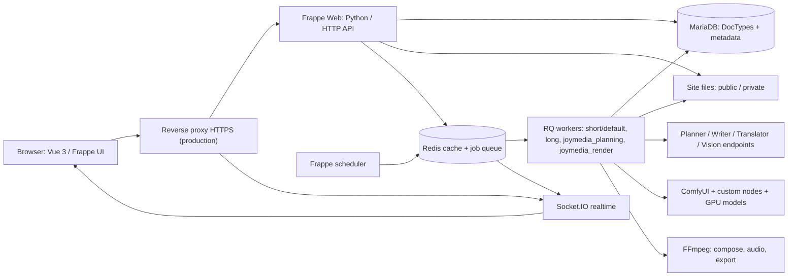
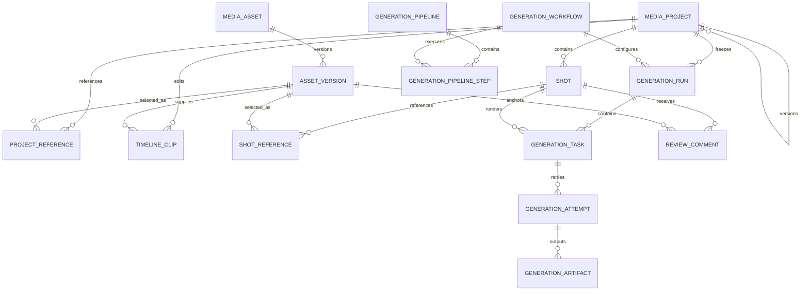
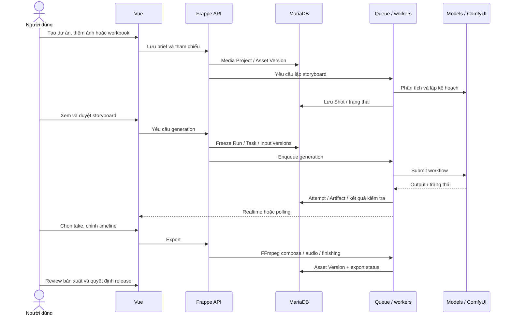

# JoyMedia — Bàn giao mã nguồn

Bản ứng dụng **0.0.1**, ngày **31/10/2026**. Đây là mã nguồn một Frappe app;
không phải toàn bộ máy chủ Frappe Bench. Mã nguồn được lấy từ working tree,
commit nền và SHA-256 từng file được ghi trong `MANIFEST.json` của ZIP.

## Nội dung bàn giao

| Hạng mục | Nội dung và vị trí trong README |
| --- | --- |
| 3. Kèm theo dữ liệu mẫu (Database) | [2 dự án Shera/Auntie, 3 video, SQL và media đi kèm](#du-lieu-mau) |
| 4. Đặt tên file nén chuẩn hóa | [Quy tắc tên, tên ZIP hiện tại và cách kiểm tra checksum](#file-nen-ban-giao) |
| 5. Kiến trúc & Sơ đồ | [Kiến trúc triển khai, cấu trúc mã nguồn, sơ đồ dữ liệu và luồng xử lý](#kien-truc-va-so-do) |
| 6. Hướng dẫn cài đặt & khởi chạy | [Các bước cài đặt, nạp demo, đăng nhập và mở ứng dụng](#cai-dat-va-khoi-chay) |

Tài liệu bổ sung: [bảo mật và phạm vi đóng gói](docs/handover/SECURITY.md),
[kết quả kiểm tra và giới hạn bàn giao](docs/handover/VALIDATION.md).

Gói gồm Python backend, Vue frontend, DocType schema/migrations, workflow graphs,
font và giấy phép, script triển khai, cấu hình mẫu, database và media của bộ demo đã chọn.
Không chứa tài khoản/mật khẩu cũ, cấu hình site thật, model weights, Git history,
môi trường Python, node_modules, log, cache hoặc frontend build.
`npm run build` sẽ tạo lại bundle và template trang trước khi mở ứng dụng.

<a id="du-lieu-mau"></a>

## Dữ liệu mẫu (Database)

Dữ liệu bàn giao: **2 dự án, 3 video thực**, thay thế hoàn toàn bộ dự án giả lập:

| Dự án | Video | Bản nguồn |
| --- | --- | --- |
| Giấy Shera | 14 và 33 | `PRJ-02558`, `PRJ-02586` |
| T-Shirt Auntie | 5 | `PRJ-02563` |

Kèm **23 cảnh, 48 clip timeline, 107 file media** (195.075.524 byte, khoảng 186 MiB),
gồm MP4 đã xuất, take dựng, ảnh/âm thanh tham chiếu và workbook liên quan.
Trong database có 5 `Media Project`: 2 dự án cha và 3 bản video con; giao diện
hiển thị đúng **2 dự án / 3 video**. Các ID nhập dùng tiền tố `JM-DEMO-`.

Schema database được Frappe tạo khi cài app; `database/sample.sql` là snapshot dữ liệu
đã chọn, không phải full backup production. Lệnh `joymedia.demo.seed.load` khôi phục
cả database và media private, kiểm tra checksum, không khởi chạy job hoặc gọi AI.
Có thể mở/xem video sẵn có mà không cần GPU. Để sinh hoặc xuất lại video cần cấu hình
planner, vision, ComfyUI, models, workers và scheduler. Lịch sử job, tài khoản,
chữ ký duyệt/release cũ không được khôi phục; xem phạm vi tại [database](database/README.md).

<a id="cai-dat-va-khoi-chay"></a>

## Cài đặt và khởi chạy

Làm lần lượt các bước dưới đây để mở JoyMedia và xem **Shera Video 14/33, Auntie Video 5**.
Phần này dành cho máy phát triển hoặc máy demo. **Không cần GPU để xem các video có sẵn**.
Tạo video mới hoặc xuất lại video cần thêm các dịch vụ AI ở phần cuối.

**Đã kiểm tra thực tế:** cài từ ZIP vào Bench và database mới, đăng nhập bằng trình duyệt,
mở đúng 2 dự án và phát/tua cả 3 video thành công. Thực hiện đủ điều kiện ở bước 1
và giữ nguyên thứ tự các bước bên dưới.

### Bước 1 — Chuẩn bị máy

Dùng Linux hoặc Ubuntu trong WSL2 nếu bạn chạy Windows. Cài các phần mềm sau trước
khi tiếp tục; cách cài phụ thuộc hệ điều hành của máy nhận:

| Phần mềm | Phiên bản / mục đích |
| --- | --- |
| Python | **3.14**, có `venv` và bộ thư viện phát triển |
| Node.js và npm | **Node 24**, dùng để cài và build giao diện |
| Yarn | Dòng **1.x (classic)**, dùng bởi Frappe |
| MariaDB | Database, cấu hình charset `utf8mb4` |
| Redis | Bộ nhớ đệm và hàng đợi tác vụ |
| Git, FFmpeg/ffprobe | Quản lý mã nguồn và xử lý media |
| Công cụ biên dịch | Compiler, `pkg-config`, thư viện phát triển MariaDB/Python |

Bật dịch vụ MariaDB và chuẩn bị thông tin quản trị database. Redis phải được cài;
Bench sẽ chạy các tiến trình Redis riêng theo cấu hình của nó khi dùng `bench start`.
Máy cần Internet để tải dependencies. Dành thêm khoảng **200 MB cho media demo**,
ngoài dung lượng source, môi trường Python, Node và database.

Có thể kiểm tra phần mềm trong terminal bằng:

```sh
python3.14 --version
node --version
npm --version
yarn --version
mariadb --version
redis-server --version
ffmpeg -version
git --version
```

Bản bàn giao được kiểm tra trên Frappe **16.33.0**, Python **3.14.7**, Node **24.20.0**
và MariaDB **11.8.9**. Chi tiết các kiểm tra và giới hạn nằm trong
[báo cáo kiểm tra](docs/handover/VALIDATION.md).

### Bước 2 — Chuẩn bị thư mục mã nguồn

Giải nén ZIP bàn giao. Trong terminal, chuyển vào thư mục vừa giải nén, nơi có
`README.md`, `pyproject.toml` và thư mục `joymedia/`:

```sh
# Thay /duong/dan/... bằng đường dẫn thật trên máy bạn.
cd /duong/dan/joymedia-v0.0.1-handover-20261031
python3.14 scripts/verify_app_layout.py

# Ghi nhớ đường dẫn source để dùng ở các bước tiếp theo.
export JOYMEDIA_SOURCE="$(pwd)"
```

**Chỉ khi dùng bản ZIP:** chạy thêm các lệnh dưới để tạo Git repository cục bộ,
cho phép Bench lấy app từ source. Nếu đã có bản clone Git thì bỏ qua khối lệnh này.
Các lệnh này không đẩy mã nguồn lên GitHub.

```sh
git init -b handover
git add .
git -c user.name='Handover' -c user.email='handover@example.invalid' commit -m 'Import handover source'
```

Để nạp đủ ba video mẫu, source phải có `joymedia/demo/records.json`,
`joymedia/demo/manifest.json` và `joymedia/demo/media/`. Bộ ZIP bàn giao có đủ các file này.
**Dùng cùng một terminal cho các bước tiếp theo** để giữ biến `JOYMEDIA_SOURCE`.

### Bước 3 — Tạo môi trường Frappe Bench

Bench là công cụ quản lý môi trường chạy Frappe. Ta tạo nó ở `~/joymedia-bench`,
tách khỏi thư mục source đã giải nén. Dùng thư mục mới, chưa có Bench khác:

```sh
python3.14 -m venv ~/.venvs/joymedia-bench-cli
~/.venvs/joymedia-bench-cli/bin/pip install 'frappe-bench==5.31.0'
export PATH="$HOME/.venvs/joymedia-bench-cli/bin:$PATH"

cd "$HOME"
bench init --python "$(command -v python3.14)" --frappe-branch v16.33.0 joymedia-bench
cd joymedia-bench

bench get-app --skip-assets joymedia "$JOYMEDIA_SOURCE"
python3.14 apps/joymedia/scripts/ensure_bench_app.py sites/apps.txt joymedia
./env/bin/pip install --only-binary=opencv-python-headless -e 'apps/joymedia[tracking,cinematography,narration]'
```

Hướng dẫn cố định Frappe ở tag **`v16.33.0`** để các lần cài dùng cùng phiên bản.
Lệnh `ensure_bench_app.py` bổ sung JoyMedia vào danh sách app của Bench; giữ nguyên
lệnh này để tránh lỗi `App joymedia not in apps.txt` khi cài từ ZIP.

### Bước 4 — Tạo database và cài ứng dụng

Vẫn ở thư mục **`~/joymedia-bench`**, chạy:

```sh
bench new-site joymedia-demo.localhost
bench --site joymedia-demo.localhost install-app joymedia
bench --site joymedia-demo.localhost set-config developer_mode 1 --parse
bench use joymedia-demo.localhost
```

`joymedia-demo.localhost` là tên site dùng xuyên suốt hướng dẫn. Lệnh `new-site` sẽ
hỏi thông tin quản trị MariaDB và cho bạn đặt mật khẩu **Administrator** của JoyMedia.
Ghi nhớ mật khẩu mới để đăng nhập; không lưu mật khẩu vào repository.
`developer_mode 1` dùng cho hướng dẫn chạy bằng `bench start`, giúp trình duyệt
kết nối đúng cổng realtime. Khi triển khai production cần cấu hình riêng và tắt chế độ này.
Nếu MariaDB nằm trong container/máy khác, thêm `--db-host <địa-chỉ-MariaDB>` vào lệnh
`bench new-site`; ví dụ tên service là `mariadb` trong môi trường container.
Trên Linux, nếu tài khoản root chỉ cho đăng nhập bằng socket, cần chuẩn bị tài khoản
quản trị MariaDB dùng mật khẩu và chỉ định `--db-root-username <tài-khoản>`.

### Bước 5 — Bật dịch vụ và build giao diện

Cần **hai terminal** ở bước này. Redis của Bench phải đang chạy trước khi chạy
`migrate`; nếu không sẽ gặp lỗi `Service redis_cache is not running`.

**Terminal 1** — tại `~/joymedia-bench`, bật các dịch vụ và giữ terminal này mở:

```sh
bench start
```

Chờ xuất hiện dòng `Running on http://127.0.0.1:8000`. Chưa mở giao diện ngay vì
các bước build/nạp dữ liệu còn ở bên dưới. Nếu terminal báo lỗi rồi tự dừng,
xử lý lỗi trước khi tiếp tục.

**Terminal 2** — mở terminal mới, rồi chạy:

```sh
export PATH="$HOME/.venvs/joymedia-bench-cli/bin:$PATH"
cd ~/joymedia-bench
bench --site joymedia-demo.localhost migrate
bench build
cd apps/joymedia/joymedia/frontend
npm ci
npm run build
cd ../../../..
```

Lệnh `cd ../../../..` đưa bạn trở lại thư mục Bench. `npm ci` dùng đúng phiên bản
trong `package-lock.json`; giữ nguyên file này. Bước build bắt buộc vì ZIP không kèm
bundle giao diện tự sinh. Nó cũng tạo template `_joymedia.html` cho trang ứng dụng.
Tiếp tục bước 6 trong **Terminal 2**, giữ **Terminal 1** chạy suốt quá trình.

### Bước 6 — Nạp Shera và Auntie

Từ thư mục **`~/joymedia-bench`**, chạy một lần:

```sh
bench --site joymedia-demo.localhost set-config joymedia_allow_demo_data 1 --parse
bench --site joymedia-demo.localhost execute joymedia.demo.seed.load
bench --site joymedia-demo.localhost set-config joymedia_allow_demo_data 0 --parse
bench --site joymedia-demo.localhost clear-cache
```

Kết quả lần nạp đầu dự kiến có `created: 652`, `projects: 2`, `videos: 3`,
`media_files: 107`. Loader kiểm tra dữ liệu và chép media vào thư mục private của site;
không gọi AI hoặc chạy lại video. Có thể chạy lại nếu cần: dữ liệu đầy đủ đã tồn tại
sẽ được bỏ qua và các chỉnh sửa được giữ nguyên.

Chỉ dùng cách nạp trên cho hướng dẫn này. Phương án SQL và xử lý bộ dữ liệu nạp dở
được giải thích trong [hướng dẫn database](database/README.md).

### Bước 7 — Đăng nhập và mở dự án

Các dịch vụ đã được bật bằng `bench start` ở **Terminal 1** từ bước 5.
Không chạy thêm một `bench start` khác vì sẽ trùng cổng. Trong trình duyệt:

1. Mở **http://joymedia-demo.localhost:8000/login**.
2. Đăng nhập bằng **Administrator** và mật khẩu đã đặt ở bước 4.
3. Mở **http://joymedia-demo.localhost:8000/joymedia/projects**.
4. Kiểm tra có **Shera: Video 14, Video 33** và **Auntie: Video 5**.
5. Mở từng video để xem MP4, storyboard và timeline.

Nếu trình duyệt không tìm thấy tên miền, thêm dòng sau vào file `hosts` của máy
đang chạy trình duyệt (Linux/macOS: `/etc/hosts`; Windows: `C:\Windows\System32\drivers\etc\hosts`):

```text
127.0.0.1 joymedia-demo.localhost
```

### Dừng và chạy lại vào lần sau

Để dừng: nhấn **Ctrl+C** trong terminal đang chạy `bench start`.
Lần sau mở terminal mới, chỉ cần:

```sh
export PATH="$HOME/.venvs/joymedia-bench-cli/bin:$PATH"
cd ~/joymedia-bench
bench start
```

Không cần tạo lại site, nạp lại database hoặc build lại giao diện nếu mã nguồn không thay đổi.

### Khi cần tạo hoặc xuất lại video

Các bước trên đủ để xem bộ demo có sẵn. Để tạo/xuất lại video, cần cấu hình thêm
planner, vision, writer/translator, ComfyUI, model, worker và scheduler.
Làm theo [hướng dẫn cấu hình AI và hàng đợi](docs/handover/INSTALLATION.md#4-cấu-hình-ai-và-hàng-đợi-khi-cần-sinh-video).

App đọc cấu hình tại `sites/joymedia-demo.localhost/site_config.json`. Tham khảo
[file cấu hình mẫu](docs/handover/site_config.example.json), chỉ bổ sung các khóa ứng dụng;
giữ nguyên thông tin database và khóa mã hóa do Bench tạo. Không đưa API key vào
frontend hay repository. Snapshot không tự bật dịch vụ GPU hoặc phục hồi job cũ.

### Lỗi thường gặp

| Hiện tượng | Cách kiểm tra |
| --- | --- |
| `bench: command not found` | Chạy lại lệnh `export PATH=...` ở phần chạy lại |
| `python3.14` hoặc `yarn` không có | Cài phần mềm còn thiếu ở bước 1 rồi kiểm tra phiên bản |
| Không kết nối được database | Kiểm tra MariaDB đã chạy và thông tin quản trị nhập ở bước 4 |
| `App joymedia not in apps.txt` | Chạy lại lệnh `ensure_bench_app.py` ở bước 3 rồi cài app |
| `Service redis_cache is not running` | Bật `bench start` ở Terminal 1, chạy `migrate` ở Terminal 2 |
| Trang trắng hoặc thiếu `_joymedia.html` | Chạy lại bước 5, clear-cache rồi khởi động lại Bench |
| Trình duyệt không tìm thấy site | Kiểm tra tên miền trong hosts và terminal `bench start` |
| Thiếu media hoặc checksum sai khi nạp | Giải nén lại đủ ZIP, không tự bỏ file trong `joymedia/demo/media` |
| Báo dữ liệu chỉ tồn tại một phần | Dùng site demo sạch hoặc khôi phục backup; không ép ghi đè |
| Bấm tạo video nhưng thiếu endpoint/model | Hoàn thành cấu hình AI; đây không phải lỗi của MP4 demo có sẵn |

`bench start` phục vụ phát triển/demo. Khi triển khai cho người dùng thật, cần
HTTPS, trình quản lý tiến trình, quyền truy cập và backup database + media + khóa mã hóa;
xem [hướng dẫn vận hành](docs/handover/INSTALLATION.md).

<a id="kien-truc-va-so-do"></a>

## Kiến trúc và sơ đồ

Sơ đồ được đối chiếu với `hooks.py`, `api/`, `services/`, Vue router và các DocType
trong bản nguồn bàn giao. Mermaid hiển thị được trên GitHub, GitLab hoặc VS Code
có hỗ trợ Mermaid. Các liên kết dưới đây là quan hệ ứng dụng/Frappe Link;
không khẳng định mọi quan hệ được tạo thành foreign key vật lý trong MariaDB.

### Thành phần triển khai



Frontend không giữ secret hay gọi thẳng MariaDB. Frappe xác thực session/CSRF,
kiểm tra quyền ở API và document level. Tác vụ dài chạy trong queue; scheduler
đồng bộ trạng thái ComfyUI và tiến trình batch. Metadata ở MariaDB, bytes của
media ở filesystem site; lưu database đơn lẻ không đủ để phục hồi media.

### Cấu trúc mã nguồn và trách nhiệm

```text
.
├── joymedia/                 # Package ứng dụng Python
│   ├── api/                  # API của ứng dụng
│   ├── services/             # Xử lý nghiệp vụ
│   ├── frontend/             # Giao diện Vue
│   ├── demo/                 # Snapshot Shera/Auntie và media
│   ├── tests/                # Kiểm thử backend
│   ├── workflow_adapters/    # Workflow và kết nối ComfyUI
│   ├── hooks.py              # Route và các hook Frappe
│   └── joymedia/             # Module Frappe: schema, controller, báo cáo
├── database/                 # SQL mẫu và hướng dẫn nạp
├── deploy/                   # Công cụ và cấu hình triển khai mẫu
├── docs/                     # Kiến trúc, sơ đồ, hướng dẫn và báo cáo kiểm tra
├── scripts/                  # Kiểm tra và đóng gói bàn giao
└── pyproject.toml            # Thông tin package và dependencies
```

| Vị trí | Chức năng |
| --- | --- |
| `joymedia/frontend/src` | Trang Projects/ProjectStudio/Assets, component, composable, state và CSS |
| `joymedia/api` | Các thao tác dự án, asset, storyboard và creative batch |
| `joymedia/services/intake`, `planning`, `scene` | Nhập tài liệu, tham chiếu, kịch bản, contract của cảnh |
| `joymedia/services/keyframes`, `generation`, `workflows` | Chuẩn bị keyframe, run/task/attempt, điều phối và kết nối ComfyUI |
| `joymedia/services/editing`, `audio`, `review`, `consistency` | Timeline, âm thanh, xuất video, kiểm tra và duyệt |
| `joymedia/services/project`, `runtime` | Phiên bản dự án, realtime, endpoint và transaction |
| `joymedia/joymedia/doctype` | Schema JSON và controller dữ liệu Frappe |
| `joymedia/patches`, `patches.txt` bên trong package | Lịch sử migration; giữ nguyên khi bàn giao |
| `joymedia/workflow_adapters/graphs` | Hợp đồng và graph workflow versioned |
| `joymedia/vendor`, `fonts` | Mã/font vendored và giấy phép cần giữ |
| `deploy`, `scripts` | Công cụ vận hành, kiểm tra, đóng gói |
| `joymedia/demo`, `database` | JSON chuẩn, loader và SQL dữ liệu mẫu |

Hai thư mục `joymedia` lồng nhau là app package và module Frappe, không phải rác.
`apps/frappe`, `apps/joymedia` trong máy phát triển là thành phần của Bench;
không đưa toàn bộ runtime Bench vào app ZIP.

### Mô hình dữ liệu chính



Đây là ERD rút gọn. Schema đầy đủ, kiểu trường, required/default, permission và
các child table khác nằm trong JSON từng DocType. Child table Frappe dùng
`parent`, `parenttype`, `parentfield`; không tự thay bằng một schema SQL khác.
Asset Version lưu phiên bản media, Generation Artifact lưu bằng chứng/output
của attempt; một lần retry không xóa lịch sử lần chạy trước.

### Luồng từ ý tưởng đến video



Export hoàn tất không đồng nghĩa video đã đạt mọi tiêu chí review/release.
Tình huống thiếu model, tham chiếu hoặc bằng chứng có thể cần người dùng xử lý.
Dữ liệu bàn giao có ba video đã dựng cùng storyboard/timeline/media. Loader khôi phục
snapshot để xem và chỉnh sửa; không khởi chạy lại chuỗi AI hoặc lịch sử job này.

## Kiểm thử khi phát triển

Sau khi cài app trên **site test riêng**, chạy từ thư mục Bench. Thay
`joymedia-test.localhost` bằng tên site test đã tạo; không chạy suite trên dữ liệu đang sử dụng.

```sh
python apps/joymedia/scripts/verify_app_layout.py
bench --site joymedia-test.localhost set-config allow_tests 1 --parse
python apps/joymedia/scripts/run_tests.py joymedia-test.localhost
cd apps/joymedia/joymedia/frontend
node --test tests/*.test.mjs
npm run build
cd ../../../..
```

`scripts/run_tests.py` chạy cả service tests mà `bench run-tests --app joymedia`
có thể không tìm thấy. Nếu đã cài công cụ pre-commit trong môi trường phát triển,
chạy `pre-commit install` tại source để bật kiểm tra định dạng/lint trước commit.

<a id="file-nen-ban-giao"></a>

## Tên file nén, đóng gói và kiểm tra bản bàn giao

Tên chuẩn: `joymedia-v<version>-handover-YYYYMMDD.zip`.
Tên bản bàn giao này: **`joymedia-v0.0.1-handover-20261031.zip`**.
Trong đó `0.0.1` là phiên bản ứng dụng, `handover` là gói bàn giao và `20261031`
là ngày đóng gói theo thứ tự năm–tháng–ngày. Script ghi ZIP và file `.zip.sha256`
vào thư mục `handover-dist/`.

Tạo lại từ thư mục mã nguồn bằng Python 3.12 trở lên:

```sh
python scripts/build_handover.py --date 20261031
```

Script loại file ngoài phạm vi, kiểm tra cú pháp Python/JSON, dò một số dạng secret
và so khớp secret trong cấu hình local (nếu có); sau đó tạo ZIP, manifest và checksum.
Khi đổi dữ liệu demo/schema, dùng thêm `--refresh-sql` rồi kiểm thử lại dữ liệu.

Kiểm tra file nhận được (Linux):

```sh
sha256sum -c joymedia-v0.0.1-handover-20261031.zip.sha256
unzip joymedia-v0.0.1-handover-20261031.zip
cd joymedia-v0.0.1-handover-20261031
sha256sum -c SHA256SUMS
```

Giấy phép app: [MIT](license.txt). Giữ các LICENSE/OFL/NOTICE của font và thư viện
vendored; model và dịch vụ AI ngoài gói có điều kiện sử dụng riêng.
