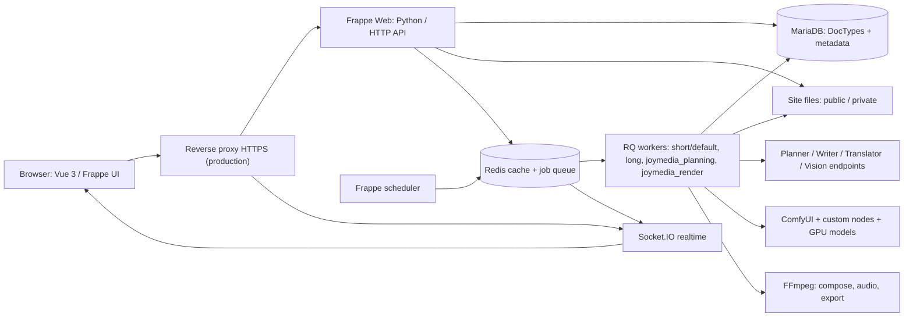
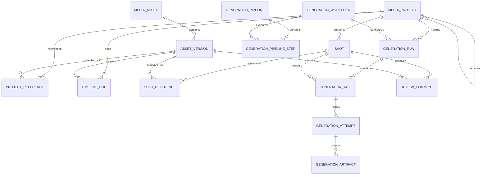
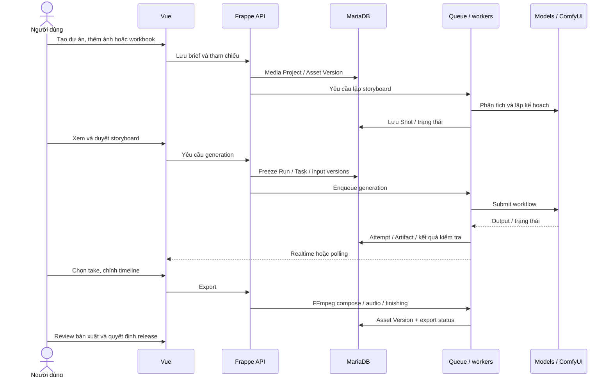

# Kiến trúc và sơ đồ

Sơ đồ được đối chiếu với `hooks.py`, `api/`, `services/`, Vue router và các DocType
trong bản nguồn bàn giao. Mermaid hiển thị được trên GitHub, GitLab hoặc VS Code
có hỗ trợ Mermaid. Các liên kết dưới đây là quan hệ ứng dụng/Frappe Link;
không khẳng định mọi quan hệ được tạo thành foreign key vật lý trong MariaDB.

## Thành phần triển khai

Frontend không giữ secret hay gọi thẳng MariaDB. Frappe xác thực session/CSRF,
kiểm tra quyền ở API và document level. Tác vụ dài chạy trong queue; scheduler
đồng bộ trạng thái ComfyUI và tiến trình batch. Metadata ở MariaDB, bytes của
media ở filesystem site; lưu database đơn lẻ không đủ để phục hồi media.

## Cấu trúc source và trách nhiệm

| Vị trí | Chức năng |
| --- | --- |
| `joymedia/frontend/src` | Trang Projects/ProjectStudio/Assets, component, composable, state và CSS |
| `joymedia/api` | Các thao tác dự án, asset, storyboard và creative batch |
| `joymedia/services/intake`, `planning`, `scene` | Nhập tài liệu, tham chiếu, kịch bản, contract của cảnh |
| `joymedia/services/keyframes`, `generation`, `workflows` | Chuẩn bị keyframe, run/task/attempt, điều phối và kết nối ComfyUI |
| `joymedia/services/editing`, `audio`, `review`, `consistency` | Timeline, âm thanh, xuất video, kiểm tra và duyệt |
| `joymedia/services/project`, `runtime` | Phiên bản dự án, realtime, endpoint và transaction |
| `joymedia/joymedia/doctype` | Schema JSON và controller dữ liệu Frappe |
| `joymedia/patches`, `patches.txt` bên trong package | Lịch sử migration; giữ nguyên khi bàn giao |
| `joymedia/workflow_adapters/graphs` | Hợp đồng và graph workflow versioned |
| `joymedia/vendor`, `fonts` | Mã/font vendored và giấy phép cần giữ |
| `deploy`, `scripts` | Công cụ vận hành, kiểm tra, đóng gói |
| `joymedia/demo`, `database` | JSON chuẩn, loader và SQL dữ liệu mẫu |

Hai thư mục `joymedia` lồng nhau là app package và module Frappe, không phải rác.
`apps/frappe`, `apps/joymedia` trong máy phát triển là thành phần của Bench;
không đưa toàn bộ runtime Bench vào app ZIP.

## Mô hình dữ liệu chính

Đây là ERD rút gọn. Schema đầy đủ, kiểu trường, required/default, permission và
các child table khác nằm trong JSON từng DocType. Child table Frappe dùng
`parent`, `parenttype`, `parentfield`; không tự thay bằng một schema SQL khác.
Asset Version lưu phiên bản media, Generation Artifact lưu bằng chứng/output
của attempt; một lần retry không xóa lịch sử lần chạy trước.

## Luồng từ ý tưởng đến video

Export hoàn tất không đồng nghĩa video đã đạt mọi tiêu chí review/release.
Tình huống thiếu model, tham chiếu hoặc bằng chứng có thể cần người dùng xử lý.
Dữ liệu bàn giao có ba video đã dựng cùng storyboard/timeline/media. Loader khôi phục
snapshot để xem và chỉnh sửa; không khởi chạy lại chuỗi AI hoặc lịch sử job này.
