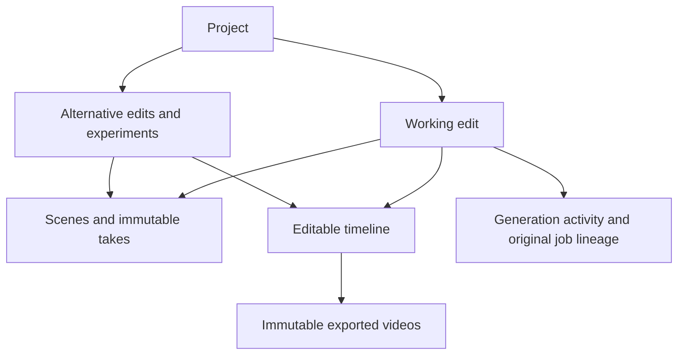

# Project edits and video history

A project is a creative brief with a chosen working edit. Alternative edits and experiments belong inside that project. Separate campaigns for the same product remain separate unless explicitly grouped. Product names never trigger automatic merging.

This follows the project/collection organization documented by [Google Flow](https://support.google.com/flow/answer/16935308?hl=en), the grouping of related generations into [Runway sessions](https://help.runwayml.com/hc/en-us/articles/33545310653203-Generating-with-Sessions), and [reversible project archiving](https://help.runwayml.com/hc/en-us/articles/55319469959699-Archiving-and-restoring-a-project). The implementation is native Frappe/Vue.

## Client flow

The workspace's **Versions & comparison** panel only browses, selects and compares
existing videos. Its **Video** and **Experiments** tabs retain the original video
numbers; filtering never renumbers a version or deletes its media. Diagnostic
edits remain available under Experiments. Older AI-created videos were also
marked Experiment, so Creative Batch provenance distinguishes those from
diagnostics; explicitly imported video numbers are retained in the normal list.
New AI-created videos are classified as Creative.

**Create another video** lives on each project card in the project overview.
It opens an explicit request using the project's references and prepares one
separate script in assisted review mode. It does not automatically render scenes.
The workspace opens the existing script-review panel when that script is ready.
Closing the creation dialog preserves the pending batch locally so reopening it
resumes progress checking instead of submitting another request.

Open the project once, then use **Versions & history**:

- **Edits**: open an alternative, name a new edit, choose the working edit, rename it, or archive/restore a nonworking alternative. The working edit is first, followed by creative edits, experiments and archived work.
- **Exported videos**: preview and download past full videos. Each entry identifies its source edit and review/release purpose. Opening its source edit opens that edit's current state, which may differ from the exported movie.
- **Scene takes**: preview earlier and current takes, inspect which is selected in its source edit, and identify reused baseline media. Selection and release approval are separate.
- **Activity**: page through previous completed, failed and cancelled generation runs instead of losing them when the newest run finishes.

The project card opens the chosen working edit. Opening an alternative does not silently change that choice. When viewing an alternative, the studio provides an explicit way back to the working edit. A completed generation is labelled **Scenes ready**, not a commercial approval. An outdated movie stays downloadable in history while the current edit offers **Export**.

## Data and code boundaries

`joymedia/services/project/versions.py` owns grouping, ownership checks, paging, edit copying, working-edit compare-and-swap and export snapshots. `ProjectHistory.vue` is shared by the project list and studio. The list page is now `Projects.vue`; the old `/campaigns` URL remains a redirect.

Existing `Media Project` rows retain their original scene, timeline and job references. `version_of` links alternatives to an explicit root; `current_edit` is a navigation preference on that root. `version_label` and `version_kind` distinguish creative edits from experiments. Parent chains, cycles, cross-owner grouping and stale working-edit writes are rejected. Only root records appear as cards and contribute to the project count.

Creating an edit copies mutable scene and timeline records, preserving the exact duration split, trim ranges, transitions, positioned clips and audio links. It creates lightweight baseline Asset Versions that reuse source files and content hashes, identify `derived_from`, and retain the original generation attempt for continuation lineage. It starts no jobs, clears release approval, and keeps the source editing state intact. Scene insertion timing and timeline normalization hooks are corrected by restoring the authored source values after all copied neighbors exist.

New exports store `edit_manifest_json` on their immutable Asset Version: project finishing state, clip sources/ranges/transitions, selected takes and timeline signature captured before rendering. Exporting does not require a generation model just to assemble this snapshot. The manifest is immutable along with the file and its hash. Existing exports with no snapshot are explicitly labelled as older exports with unavailable edit snapshots; their past timeline is not guessed. Automatic reconstruction of those old editing states is not provided.

Archiving preserves outputs and history and rejects active jobs. The chosen working child must be changed before that child can be archived. Archived families remain readable and are restored from the Archived list before editing or generating. The live-render fixture helper now creates an Experiment edit inside its source family, leaves the client's working choice intact, and clears experimental keyframe approvals so opt-in live tests really redraw through the UI.

## Deployment

Normal deployment synchronizes the four new Media Project fields and the one Asset Version snapshot field through the app schema. No business-specific grouping runs automatically. For existing duplicate workspaces, use explicit reviewed inputs to `organize_edits`, then `set_working_edit`; both enforce owner access and family invariants.

Before reorganizing existing data, retain a database backup and record immutable media/job inventories. Grouping changes only organization fields; it does not reparent generation jobs or rewrite frozen snapshots. Keep any business-specific legacy grouping plan outside application logic.
